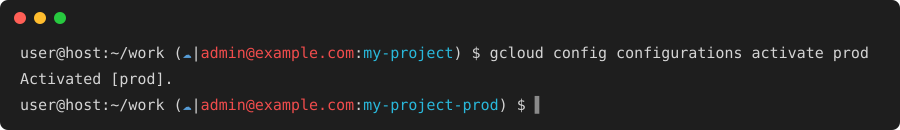

# gcloud-ps1

[](https://github.com/motuneko253/gcloud-ps1/actions/workflows/ci.yml)
[](LICENSE)

今アクティブな gcloud の構成(アカウントとプロジェクト)を、bash / zsh のプロンプトに表示するスクリプトです。



本番プロジェクトで `gcloud` を叩く前に、今どのアカウント・プロジェクトを向いているかをひと目で確認できます。

## 特徴

- `gcloud` コマンドを実行せず、構成ファイルを直接読むだけなので軽い(1 回あたり約 2ms)
- `gcloud config configurations activate` などで構成を切り替えても、次のプロンプトですぐ反映される
- 色、区切り文字、表示する項目を環境変数で変更できる
- プロジェクト名に応じて色を変えられる(本番だけ赤にする、など)
- サービスアカウントの impersonate を使っているときは、その旨も表示する
- bash と zsh の両方に対応

## 動作環境

| シェル | 確認したバージョン |
|---|---|
| bash | 3.2 / 4.4 / 5.2 |
| zsh | 5.9 |

bash 3.2 と 4.4 は Linux 上(Docker の公式イメージ)でテストを通しています。CI でも毎回実行します。macOS の実機では確認していません。

## インストール

リポジトリを取得して、シェルの設定ファイルから `source` します。

```bash
git clone https://github.com/motuneko253/gcloud-ps1.git ~/gcloud-ps1
```

### bash

`~/.bashrc` に追記します。

```bash
source ~/gcloud-ps1/gcloud-ps1.sh
PS1='\u@\h:\w $(gcloud_ps1) \$ '
```

PS1 は必ずシングルクォートで書いてください。ダブルクォートだと `$(...)` が代入時に 1 回だけ評価され、構成を切り替えても表示が変わりません。

### zsh

`~/.zshrc` に追記します。

```zsh
source ~/gcloud-ps1/gcloud-ps1.sh
PROMPT='$(gcloud_ps1) '$PROMPT
```

zsh では `PROMPT_SUBST` を自動で有効にします。

`gcloud_ps1` は直前のコマンドの終了コードをそのまま返します。プロンプトの後ろのほうで `$?` を表示していても、値は変わりません。

### 更新とアンインストール

更新するときは、取得したディレクトリで `git pull` します。

```bash
git -C ~/gcloud-ps1 pull
```

やめるときは、設定ファイルに追記した行を消して、ディレクトリを削除します。`gcloudoff -g` を使ったことがある場合は、`~/.config/gcloud-ps1` も削除してください。

## 表示される内容

```
(☁|admin@example.com:my-project)
```

左から、記号(`☁`)、区切り(`|`)、アカウント、区切り(`:`)、プロジェクトです。
構成名や impersonate 先も、設定で追加できます。

値は gcloud 本体と同じ優先順位で決めます。

| 項目 | 優先順位 |
|---|---|
| アカウント | 環境変数 `CLOUDSDK_CORE_ACCOUNT` → 構成の `[core] account` |
| プロジェクト | 環境変数 `CLOUDSDK_CORE_PROJECT` → 構成の `[core] project` |
| 構成名 | 環境変数 `CLOUDSDK_ACTIVE_CONFIG_NAME` → `active_config` ファイル → `default` |
| impersonate | 環境変数 `CLOUDSDK_AUTH_IMPERSONATE_SERVICE_ACCOUNT` → 構成の `[auth] impersonate_service_account` |

構成ファイルの場所は `$CLOUDSDK_CONFIG`(未設定なら `~/.config/gcloud`)です。
値が無いときは `N/A` と表示します。アカウント・プロジェクト・impersonate の環境変数は、空文字で定義されていても構成ファイルより優先します(gcloud 本体と同じ挙動です)。

### impersonate 中の表示

`auth/impersonate_service_account` を設定していると、実際の API 呼び出しはログイン中のアカウントではなくサービスアカウントの権限で行われます。取り違えを防ぐため、設定されているときはアカウントの後ろに表示します。

```
(☁|admin@example.com→deploy@my-project.iam.gserviceaccount.com:my-project)
```

不要な場合は `GCLOUD_PS1_IMPERSONATE_ENABLE=false` で消せます。アカウントを非表示にしているときは、矢印を付けずにサービスアカウントだけを表示します。

## 設定

設定はすべて環境変数です。`source` の前後どちらで設定しても動きます。

### 表示する項目

| 変数 | 既定値 | 説明 |
|---|---|---|
| `GCLOUD_PS1_SYMBOL_ENABLE` | `true` | 記号を表示する |
| `GCLOUD_PS1_CONFIG_ENABLE` | `false` | 構成名を表示する |
| `GCLOUD_PS1_ACCOUNT_ENABLE` | `true` | アカウントを表示する |
| `GCLOUD_PS1_PROJECT_ENABLE` | `true` | プロジェクトを表示する |
| `GCLOUD_PS1_IMPERSONATE_ENABLE` | `true` | impersonate 先を表示する(設定されているときのみ) |
| `GCLOUD_PS1_HIDE_IF_NOCONFIG` | `false` | アカウント・プロジェクト・impersonate のどれも無いときは何も表示しない |

### 文字

| 変数 | 既定値 | 説明 |
|---|---|---|
| `GCLOUD_PS1_SYMBOL_CUSTOM` | `☁` | 記号 |
| `GCLOUD_PS1_SYMBOL_PADDING` | `false` | 記号の後ろに空白を入れる |
| `GCLOUD_PS1_PREFIX` | `(` | 先頭の文字 |
| `GCLOUD_PS1_SUFFIX` | `)` | 末尾の文字 |
| `GCLOUD_PS1_SEPARATOR` | `\|` | 記号と本体の間 |
| `GCLOUD_PS1_DIVIDER` | `:` | 構成名・アカウント・プロジェクトの間 |
| `GCLOUD_PS1_IMPERSONATE_ARROW` | `→` | アカウントと impersonate 先の間 |
| `GCLOUD_PS1_ACCOUNT_MODE` | `full` | アカウントの表示形式。`full` は全体、`user` は `@` より前、`domain` は `@` より後(該当部分が無ければ `N/A`) |
| `GCLOUD_PS1_NA` | `N/A` | 値が無いときの表示 |

### 色

色は `black` `red` `green` `yellow` `blue` `magenta` `cyan` `white` のいずれか、または `0`〜`255` の数値で指定します。空文字にすると色なしになります。

| 変数 | 既定値 | 対象 |
|---|---|---|
| `GCLOUD_PS1_SYMBOL_COLOR` | `blue` | 記号 |
| `GCLOUD_PS1_CONFIG_COLOR` | `yellow` | 構成名 |
| `GCLOUD_PS1_ACCOUNT_COLOR` | `red` | アカウント |
| `GCLOUD_PS1_PROJECT_COLOR` | `cyan` | プロジェクト |
| `GCLOUD_PS1_IMPERSONATE_COLOR` | `magenta` | impersonate 先 |
| `GCLOUD_PS1_DIVIDER_COLOR` | なし | `DIVIDER` |
| `GCLOUD_PS1_SEPARATOR_COLOR` | なし | `SEPARATOR` |
| `GCLOUD_PS1_PREFIX_COLOR` | なし | `PREFIX` |
| `GCLOUD_PS1_SUFFIX_COLOR` | なし | `SUFFIX` |
| `GCLOUD_PS1_BG_COLOR` | なし | 全体の背景色 |

### 表示や色を関数で決める

| 変数 | 説明 |
|---|---|
| `GCLOUD_PS1_ACCOUNT_FUNCTION` | アカウントの表示を加工する関数名。引数は表示する値、出力が表示になる |
| `GCLOUD_PS1_PROJECT_FUNCTION` | プロジェクトの表示を加工する関数名 |
| `GCLOUD_PS1_ACCOUNT_COLOR_FUNCTION` | アカウントの色を返す関数名。引数は元の値、出力が色になる |
| `GCLOUD_PS1_PROJECT_COLOR_FUNCTION` | プロジェクトの色を返す関数名 |

- 加工する関数には、`GCLOUD_PS1_ACCOUNT_MODE` を適用した後の値が渡ります。値が無いときは `N/A`(`GCLOUD_PS1_NA` の値)が渡ります。
- 色を返す関数には、加工する前の値が渡ります。値が無いときは空文字が渡ります。
- 呼ばれるのは、現在のシェルで定義済みのシェル関数だけです。外部コマンドは実行しません。
- 関数が未定義、または失敗したときは、元の値と既定の色を使います。
- 関数を 1 つ指定するごとに、プロンプトの描画でサブシェルが 1 つ増えます。

## 使用例

### 本番プロジェクトだけ赤くする

```bash
_gcloud_project_color() {
  case "$1" in
    *-prod | *-production) echo red ;;
    *) echo green ;;
  esac
}
export GCLOUD_PS1_PROJECT_COLOR_FUNCTION=_gcloud_project_color
```

### 記号を消して、アカウントは `@` より前だけ表示する

```bash
export GCLOUD_PS1_SYMBOL_ENABLE=false
export GCLOUD_PS1_ACCOUNT_MODE=user
```

### プロジェクト名を短くする

```bash
_short_project() { echo "${1##*-}"; }
export GCLOUD_PS1_PROJECT_FUNCTION=_short_project
```

### 括弧と区切りに色を付ける

```bash
export GCLOUD_PS1_PREFIX_COLOR=yellow
export GCLOUD_PS1_SUFFIX_COLOR=yellow
export GCLOUD_PS1_DIVIDER_COLOR=yellow
```

## コマンド

表示のオン・オフを切り替えるコマンドです。

| コマンド | 動作 |
|---|---|
| `gcloudoff` | 今のシェルだけ非表示にする |
| `gcloudon` | 今のシェルだけ表示する |
| `gcloudoff -g` | すべてのシェルで非表示にする |
| `gcloudon -g` | すべてのシェルで表示に戻す |

`-g` を付けると、`${XDG_CONFIG_HOME:-$HOME/.config}/gcloud-ps1/disabled` というファイルを作る(消す)ことで切り替えます。
`-g` なしの設定(環境変数 `GCLOUD_PS1_ENABLED`)は、全体の設定より優先されます。

## 仕様と制限

### 構成名の扱い

gcloud 本体の挙動に合わせています。

- 環境変数 `CLOUDSDK_ACTIVE_CONFIG_NAME` は形式を検証せず、そのまま `config_<名前>` を読みます。ファイルが無ければ `N/A` です。`/` を含む名前は拒否します。
- `active_config` ファイルの中身が `^[a-z][-a-z0-9]*$` に合わないときは `default` として扱います。空のときも `default` です。
- 名前の末尾に改行があるとき(`echo foo > active_config` で書いた場合など)は、その名前のファイルが存在しないため `N/A` になります。gcloud 本体でも値なしになります。CRLF も同様です。
- `NONE` は「構成なし」として `N/A` を表示します。

### 構成ファイル(INI)の読み取り

gcloud は Python の `configparser` で構成ファイルを読みます。このスクリプトは、gcloud 自身が書き出す形式に絞って読みます。

- 対応しているもの
  - `key = value` と `key: value`(区切りは最初に現れる `=` か `:`)
  - 見出し行の後ろのコメント(`[core] # comment`)
  - 直前のキーより深く字下げされた継続行(読み飛ばします)
- 対応していないもの
  - 大文字を含むキー(`Project = x` など)
  - `%(...)s` による値の補間
  - `[DEFAULT]` セクションの継承
  - SDK のインストール先にある `properties` ファイル

手で構成ファイルを書き換えて上のような書き方をしている場合は、gcloud 本体と表示が食い違うことがあります。

### そのほか

- GCE の VM 上では、構成が未設定でも gcloud がメタデータサーバーから値を補います。プロンプトのたびにネットワークへ問い合わせるのは避けたいので、これには対応していません。その場合は `N/A` になります。
- 表示する値は 256 文字で切り詰めます(超えた分は `…` になります)。
- 値に含まれる制御文字は取り除きます。zsh では `%` もエスケープします。構成ファイルや環境変数の内容が、プロンプトの制御に使われないようにするためです。
- `HOME` も `CLOUDSDK_CONFIG` も未設定のときは、構成ファイルを読まずに `N/A` を表示します。

## 開発

```bash
shellcheck -s bash gcloud-ps1.sh test/run.sh test/cases.sh
shfmt -d gcloud-ps1.sh test/run.sh test/cases.sh
test/run.sh
```

`test/run.sh` は bash と(入っていれば)zsh でテストを実行します。構成ファイルは一時ディレクトリに作るので、実際の gcloud の設定には触れません。
使うシェルを指定したいときは、空白区切りで `GCLOUD_PS1_TEST_SHELLS="bash /path/to/zsh" test/run.sh` のように渡します。

GitHub Actions でも、`main` への push と pull request のたびに同じ内容を実行します。あわせて、bash 3.2 と 4.4 でもテストを実行します。

[pre-commit](https://pre-commit.com/) も設定してあります。コミット前に `shellcheck`、`shfmt`、テストなどを自動で実行します。

```bash
pre-commit install
pre-commit run --all-files   # 全ファイルに対して手動で実行
```

## 不具合の報告と要望

不具合や要望は [Issues](https://github.com/motuneko253/gcloud-ps1/issues) にお願いします。不具合の場合は、シェルの種類とバージョン、設定している `GCLOUD_PS1_*` の値、期待した表示と実際の表示を書いてもらえると助かります。構成ファイルを貼るときは、アカウントやプロジェクト ID を伏せてください。

Pull request も歓迎します。送る前に、上の「開発」のコマンドが通ることを確認してください。

## ライセンス

[MIT License](LICENSE)

## 参考

- [gcloud CLI の構成](https://cloud.google.com/sdk/docs/configurations)
